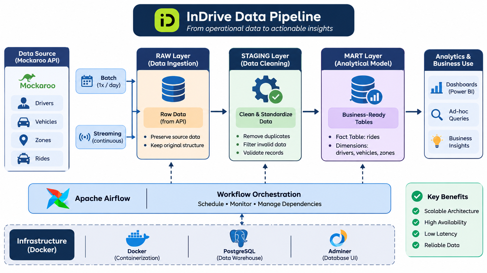
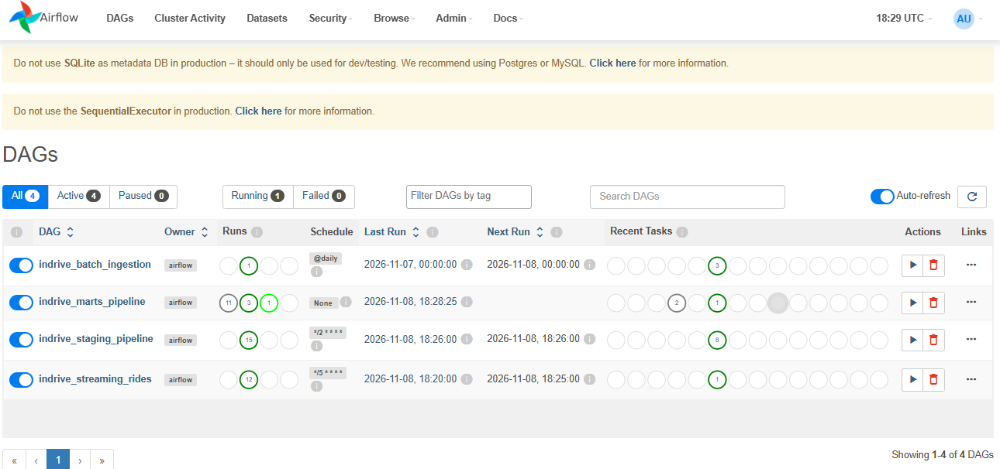
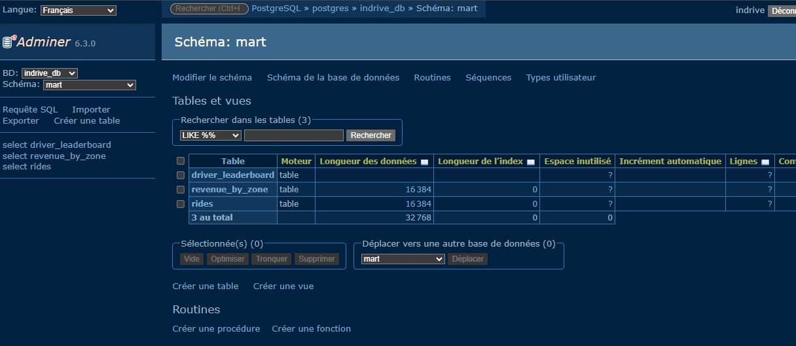

# InDrive Data Pipeline

An end-to-end Data Engineering project that simulates an InDrive ride-hailing platform data pipeline using batch and streaming ingestion, data transformation, orchestration, and analytical data modeling.

The project demonstrates how raw operational data can be collected from an API, processed through multiple data layers, and transformed into structured analytical tables ready for reporting and business analysis.

## Architecture Overview

The pipeline follows an ELT architecture, organized into three
main data layers: RAW, STAGING, and MART.

### 1. Data Source – Mockaroo API

Mockaroo is used as a simulated data source to generate realistic datasets representing the operational activities of an InDrive-like ride-hailing platform.

The pipeline consumes four main datasets:

| Dataset | Description |
|---|---|
| `drivers` | Driver information and ratings |
| `vehicles` | Vehicle information |
| `zones` | Geographic and service zone information |
| `rides` | Ride transactions and operational metrics |

These datasets represent the core entities of the ride-hailing business.

### 2. Data Ingestion: Batch & Streaming

The ingestion layer uses two different approaches depending on the nature and frequency of the data.

**Batch Ingestion**

Batch processing is used for relatively stable reference datasets:

- `drivers`
- `vehicles`
- `zones`

These datasets are extracted from the API and loaded periodically into the RAW layer (once per day).

**Streaming Ingestion**

The `rides` dataset follows a streaming ingestion approach because ride transactions are continuously generated by the platform.

New ride records are retrieved and ingested at regular intervals, simulating a continuous flow of operational events.

This separation allows the pipeline to handle both slowly changing reference data and frequently generated transactional data.

### 3. RAW Layer – Data Ingestion

The RAW layer is the first storage layer of the pipeline.

Its purpose is to preserve the ingested source data before applying business transformations.

Key characteristics:

- Stores data as received from the source.
- Maintains the original structure of incoming datasets.
- Separates ingestion from transformation logic.
- Provides a reference point for data validation and troubleshooting.

The RAW layer contains the initial versions of the four datasets:

`raw.drivers`, `raw.vehicles`, `raw.zones`, `raw.rides`

### 4. STAGING Layer – Data Cleaning & Standardization

The STAGING layer transforms raw records into clean and consistent datasets.

It is responsible for applying data quality rules before analytical modeling.

Main transformations include:

- Removing duplicate ride records.
- Filtering records with null or invalid fare amounts.
- Validating driver references.
- Excluding rides associated with non-existent drivers.
- Standardizing data before downstream transformations.

For example, ride records with a null or negative fare, or an invalid `driver_id`, are excluded from the cleaned dataset.

This layer centralizes transformation and validation logic, ensuring that downstream analytical tables are built from consistent data.

### 5. MART Layer – Analytical Data Modeling

The MART layer contains business-oriented tables designed for analytical queries and reporting.

It transforms cleaned operational data into meaningful information that can support business analysis.

The data model follows a dimensional modeling approach, separating transactional measures from descriptive attributes.

**Fact Table – `mart.rides`**

The central analytical table represents ride transactions.

Its grain is:

One row represents one unique ride.

It combines transactional metrics such as:

- Fare amount
- Ride distance
- Driver rating
- Ride information
- Driver and geographic attributes

**Dimensions**

Descriptive information enriches the ride transactions:

- Drivers: driver profiles and ratings.
- Vehicles: vehicle characteristics.
- Zones: geographic information.

This structure makes it easier to analyze ride activity across different business dimensions.

### 6. Workflow Orchestration – Apache Airflow

Apache Airflow manages and orchestrates the different pipeline workflows through Directed Acyclic Graphs (DAGs).

It coordinates the execution of ingestion and transformation tasks.

The orchestration layer is responsible for:

- Scheduling batch ingestion.
- Managing ride data ingestion.
- Executing staging transformations.
- Building analytical marts.
- Managing task dependencies.
- Monitoring execution status and failures.

Each DAG represents an automated workflow, allowing the pipeline to run in a structured and repeatable manner.

### 7. Infrastructure & Database Management

The project uses Docker to run the main infrastructure components in a containerized environment.

| Component | Responsibility |
|---|---|
| Docker | Containerization and service deployment |
| PostgreSQL | Relational database and data warehouse |
| Apache Airflow | Pipeline orchestration |
| Adminer | Database management and inspection |
| Mockaroo API | Simulated data generation |

**Adminer** provides a graphical interface to inspect PostgreSQL schemas, tables, and records across the different data layers.

## Data Quality & Reliability

Data quality is addressed during the staging process to ensure that only valid records reach the analytical layer.

The pipeline applies several validation rules:

- Duplicate detection.
- Null and invalid fare filtering.
- Referential integrity checks.
- Validation of driver identifiers.
- Consistent analytical table reconstruction.

The transformation workflows use a `DROP TABLE` followed by `CREATE TABLE AS` approach for rebuilding their output tables. This makes repeated executions deterministic for the same input data and avoids accumulating duplicate records across runs.

## Project Execution & Validation

The pipeline execution was verified through Apache Airflow and PostgreSQL.

**Airflow – Workflow Monitoring**

All four DAGs completed successfully, confirming that the configured workflows executed without reported failures.

**Adminer – Analytical Data Validation**

The three analytical tables were successfully created in the PostgreSQL `mart` schema.

## Key Data Engineering Concepts

This project puts into practice several fundamental Data Engineering concepts:

- Batch and streaming data ingestion.
- ELT architecture.
- Data lake and warehouse layering principles.
- Data cleaning and validation.
- Referential integrity.
- Dimensional modeling (facts and dimensions).
- Data pipeline orchestration with Apache Airflow.
- Containerized infrastructure with Docker.
- Analytical data preparation.

## Conclusion

This project demonstrates the implementation of a structured data pipeline, from API-based ingestion to analytical data modeling.

By combining batch and streaming ingestion, layered data transformations, workflow orchestration, and dimensional modeling, it provides a practical foundation for understanding how operational data can be transformed into reliable analytical datasets.

